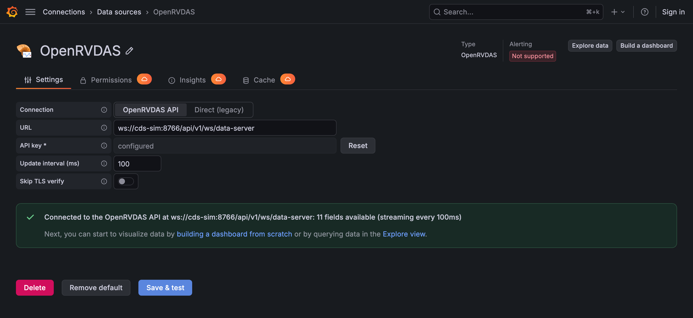

# OpenRVDAS Data Source

## Overview / Introduction

Real-time streaming of [OpenRVDAS](https://github.com/OceanDataTools/openrvdas) data into Grafana dashboards.

The data source connects to an OpenRVDAS **CachedDataServer**, through the OpenRVDAS API with an API key or directly, and streams the fields you choose through Grafana Live at up to 10 Hz. Panels show the current value as soon as they load and then update continuously. It pairs well with the OceanDataTools [compass](https://grafana.com/grafana/plugins/oceandatatools-compass-panel/), [attitude](https://github.com/OceanDataTools/grafana-attitude-panel) and windrose panels.

This data source is for **live** data only. For historical data, use the database OpenRVDAS writes to (e.g. InfluxDB) with its own Grafana data source. Alerting is not supported yet.

## Features

- Live streaming of any CachedDataServer field at up to 10 Hz, through Grafana Live.
- The latest value on load, so instrument panels are never blank while waiting for data.
- Authenticated, read-only connection through the OpenRVDAS API with an API key, or a direct connection to the CachedDataServer.
- Field picker that lists the server's fields, with `*` wildcards (e.g. `S330*`) and dashboard variables.
- Units and descriptions from OpenRVDAS metadata (degrees, knots, °C and more map to Grafana units).
- Per-query minimum interval, to slow down fields you don't need at full rate.
- A warning when a field's latest value is older than the panel's time range, which usually means its logger isn't running.

## Requirements

- Grafana 12.0.10 or newer (12.0.10+, 12.1.7+, 12.2.5+, 13.x)
- An OpenRVDAS server reachable **from the Grafana server**. Browsers don't need direct access to it. Either:
  - the OpenRVDAS API (recommended), which provides an authenticated proxy at `/api/v1/ws/data-server`, plus an API key, or
  - direct network access to the CachedDataServer (port 8766). This is unauthenticated and scheduled for removal in OpenRVDAS v3 ([openrvdas#748](https://github.com/OceanDataTools/openrvdas/issues/748)).

## Configuration

| Setting                  | Description                                                                                                                                                                    |
| ------------------------ | ------------------------------------------------------------------------------------------------------------------------------------------------------------------------------ |
| **Connection**           | **OpenRVDAS API** (default for new data sources): authenticated, read-only, with an API key. **Direct (legacy)**: unauthenticated connection straight to the CachedDataServer. |
| **URL**                  | OpenRVDAS API: `wss://<host>/api/v1/ws/data-server` (`ws://` without TLS). Direct: `ws://<host>:8766`.                                                                         |
| **API key**              | OpenRVDAS API only. Stored encrypted; see below.                                                                                                                               |
| **Update interval (ms)** | How often the CachedDataServer sends new data. Default 100 ms (10 Hz).                                                                                                         |
| **Skip TLS verify**      | Accept self-signed certificates for `wss://` URLs.                                                                                                                             |

**Save & test** connects to the server and reports how many fields are available. With the OpenRVDAS API, it tells you if the API key was rejected.

### Creating an API key

API keys need the OpenRVDAS **React** web console, which provides the API. Switch an installation to it with `utils/switch_ui.sh react` in OpenRVDAS. With the Django console there's no API and no API keys, so use the **Direct** connection.

In the React web console, open the **API Keys** page and create a key with the **WEBSOCKET** permission on `/api/v1/ws/data-server`. Paste it into the data source's **API key** field. The plugin only reads data and never needs write permissions.

Grafana stores the key encrypted. Only the Grafana server uses it, sending it in the `X-API-Key` header when connecting, so browsers never see it.

## Queries

- **Fields**: pick one or more fields, or type a pattern with `*` (e.g. `S330*`, `Mwx*Wind*`). Dashboard variables can be used.
- **Min interval (ms)**: optionally slow a query down to one value (the most recent) per interval.
- **Stream**: on by default. Turn it off to return only the latest values.

Each field becomes its own series, named after the field, with units and descriptions taken from OpenRVDAS metadata when available.

If a field's latest value is older than the start of the panel's time range, the panel shows a warning with the value's age (e.g. _AvgPortTrueWindSpeed (23 h old). Is its logger running?_). Grafana would otherwise show only "Data outside time range". The CachedDataServer keeps a field's last value after its logger stops, so this usually means the logger isn't running.

## Tips for live dashboards

- Leave the dashboard's auto-refresh **off**. Streaming panels update themselves, and auto-refresh only re-runs the initial query.
- For panels that animate (compass, attitude, …), set the animation duration to the update interval or less (e.g. 100 ms or 0). Otherwise the needle lags behind the data.
- To combine fast data (attitude at 10 Hz) with slow data (weather at 1 Hz) efficiently, use **Min interval** on the slow queries, or configure a second data source with a longer update interval.

## Feedback and contributing

Report bugs and request features in the [issue tracker](https://github.com/OceanDataTools/grafana-openrvdas-datasource/issues). To work on the plugin, see [CONTRIBUTING.md](https://github.com/OceanDataTools/grafana-openrvdas-datasource/blob/main/CONTRIBUTING.md).

## License

The plugin is licensed under the [MIT License](https://github.com/OceanDataTools/grafana-openrvdas-datasource/blob/main/LICENSE).

The plugin logo is the exception. Its nautilus is "Nautilus" by Ulisse Perusin, the GNOME Nautilus icon used in the OpenRVDAS web frontend, which is licensed under the [GNU General Public License version 2](https://github.com/OceanDataTools/grafana-openrvdas-datasource/blob/main/src/img/GPL-2.0.txt). The logo is a derivative of that icon, so it is also licensed under GPL-2.0.
