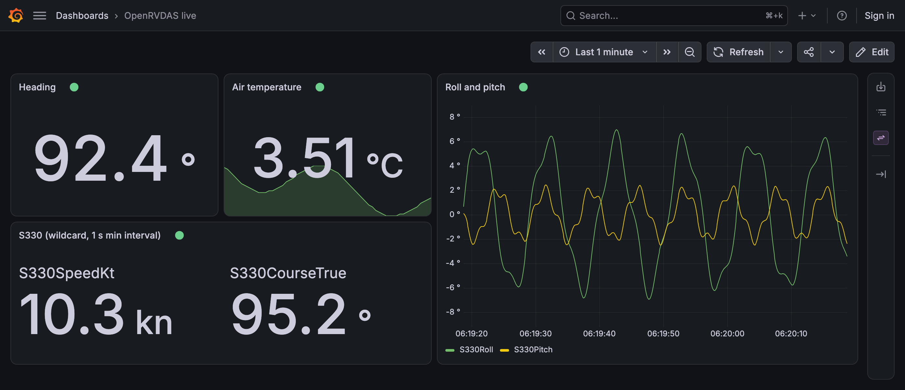
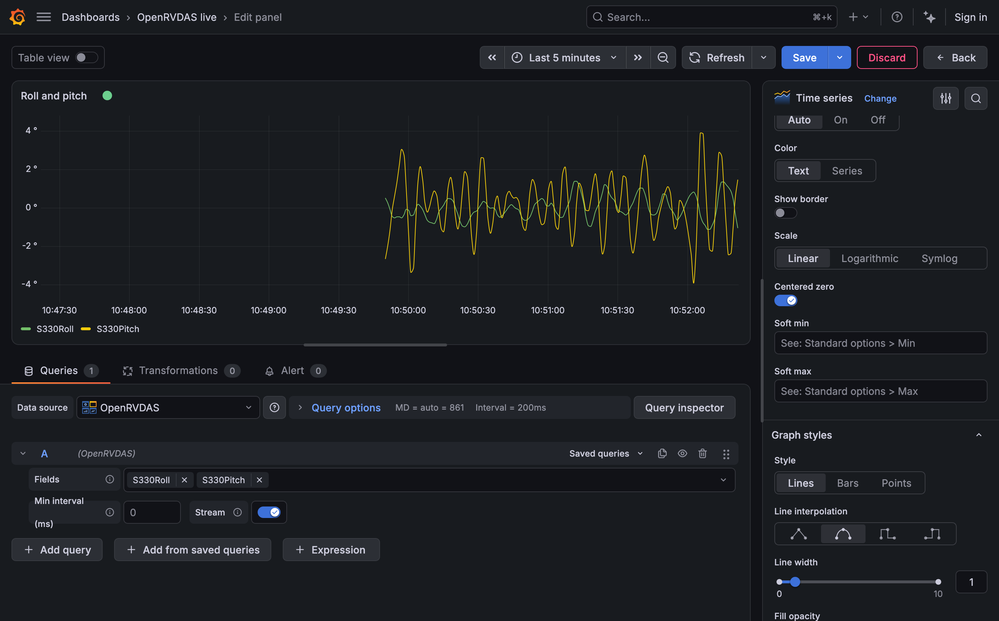

# OpenRVDAS Data Source

Real-time streaming of [OpenRVDAS](https://github.com/OceanDataTools/openrvdas) data into Grafana dashboards.

The data source connects to an OpenRVDAS **CachedDataServer**, through the OpenRVDAS API with an API key or directly, and streams the fields you choose through Grafana Live at up to 10 Hz. Panels show the current value as soon as they load and then update continuously. It pairs well with the OceanDataTools compass, attitude and windrose panels.



This data source is for **live** data only. For historical data, use the database OpenRVDAS writes to (e.g. InfluxDB) with its own Grafana data source.

## Requirements

- Grafana 12.0.10 or newer (12.0.10+, 12.1.7+, 12.2.5+, 13.x)
- An OpenRVDAS server reachable **from the Grafana server**. Browsers don't need direct access to it. Either:
  - the OpenRVDAS API (recommended), which provides an authenticated proxy at `/api/v1/ws/data-server`, plus an API key, or
  - direct network access to the CachedDataServer (port 8766). This is unauthenticated and scheduled for removal in OpenRVDAS v3 ([openrvdas#748](https://github.com/OceanDataTools/openrvdas/issues/748)).

## Installation

Until the plugin is in the Grafana plugin catalog, install a development build by hand. See [docs/INSTALL-DEV.md](docs/INSTALL-DEV.md) for building, installing into an existing Grafana (Linux, Docker, macOS, Windows), allowing the unsigned plugin, configuring a reverse proxy for live streaming, and troubleshooting.

## Configuration

| Setting | Description |
|---|---|
| **Connection** | **OpenRVDAS API** (default for new data sources): authenticated, read-only, with an API key. **Direct (legacy)**: unauthenticated connection straight to the CachedDataServer. |
| **URL** | OpenRVDAS API: `wss://<host>/api/v1/ws/data-server` (`ws://` without TLS). Direct: `ws://<host>:8766`. |
| **API key** | OpenRVDAS API only. Stored encrypted; see below. |
| **Update interval (ms)** | How often the CachedDataServer sends new data. Default 100 ms (10 Hz). |
| **Skip TLS verify** | Accept self-signed certificates for `wss://` URLs. |


**Save & test** connects to the server and reports how many fields are available. With the OpenRVDAS API, it tells you if the API key was rejected.

### Creating an API key

API keys need the OpenRVDAS **React** web console, which provides the API. Switch an installation to it with `utils/switch_ui.sh react` in OpenRVDAS. With the Django console there's no API and no API keys, so use the **Direct** connection.

In the React web console, open the **API Keys** page and create a key with the **WEBSOCKET** permission on `/api/v1/ws/data-server`. Paste it into the data source's **API key** field. The plugin only reads data and never needs write permissions.

Grafana stores the key encrypted. Only the Grafana server uses it, sending it in the `X-API-Key` header when connecting, so browsers never see it.

## Queries

- **Fields**: pick one or more fields, or type a pattern with `*` (e.g. `S330*`, `Mwx*Wind*`). Dashboard variables can be used.
- **Min interval (ms)**: optionally slow a query down to one value (the most recent) per interval.
- **Stream**: on by default. Turn it off to return only the latest values.



Each field becomes its own series, named after the field, with units and descriptions taken from OpenRVDAS metadata when available.

If a field's latest value is older than the start of the panel's time range, the panel shows a warning with the value's age (e.g. *AvgPortTrueWindSpeed (23 h old). Is its logger running?*). Grafana would otherwise show only "Data outside time range". The CachedDataServer keeps a field's last value after its logger stops, so this usually means the logger isn't running.

## Tips for live dashboards

- Leave the dashboard's auto-refresh **off**. Streaming panels update themselves, and auto-refresh only re-runs the initial query.
- For panels that animate (compass, attitude, …), set the animation duration to the update interval or less (e.g. 100 ms or 0). Otherwise the needle lags behind the data.
- To combine fast data (attitude at 10 Hz) with slow data (weather at 1 Hz) efficiently, use **Min interval** on the slow queries, or configure a second data source with a longer update interval.

## License

The plugin is licensed under the [MIT License](LICENSE).

The plugin logo ([`src/img/logo.svg`](src/img/logo.svg)) is the exception. Its nautilus is "Nautilus" by Ulisse Perusin, the GNOME Nautilus icon used in the OpenRVDAS web frontend, which is licensed under the GNU General Public License version 2. The logo is a derivative of that icon, so it is also licensed under GPL-2.0; the full text is in [`src/img/GPL-2.0.txt`](src/img/GPL-2.0.txt).

## Development

See [docs/DESIGN.md](docs/DESIGN.md) for the architecture.

Prerequisites: Node 24.5+ (`.nvmrc`), Go (see `go.mod`), [mage](https://magefile.org), Docker.

```bash
npm install
npm run dev                      # frontend, watch mode
mage -v build:linuxARM64         # backend for the dev container (build:linux on x86_64); rerun after Go changes
npm run server                   # Grafana at http://localhost:3000 with the "OpenRVDAS live" dashboard
```

`npm run server` also starts `cds-sim`, a simulated CachedDataServer (`cmd/cds-sim`) with 10 Hz attitude and 1 Hz navigation and met fields. The provisioned data source uses it by default, through the OpenRVDAS API path with a dummy key, so a fresh checkout works with no OpenRVDAS install. To use a real OpenRVDAS instead, put the connection in a git-ignored `.env`:

```bash
# OpenRVDAS API (authenticated)
CDS_CONNECTION_MODE=proxy
CDS_URL=wss://<host>/api/v1/ws/data-server
OPENRVDAS_API_KEY=<key>
# or direct (legacy, unauthenticated)
CDS_CONNECTION_MODE=direct
CDS_URL=ws://<host>:8766
```

Tests:

```bash
go test -race ./pkg/...                                            # Go unit, fake-CDS protocol and simulator tests
CDS_URL=ws://<cds-host>:8766 go test -tags integration -v ./pkg/cds/   # against a real CDS (add OPENRVDAS_API_KEY for the proxy)
npm run test:ci                                                    # Jest
npm run e2e                                                        # Playwright; needs the server running (simulator or a live CDS)
GRAFANA_VERSION=12.0.10 npm run server                             # test the oldest supported Grafana
```

`mage -v` builds the backend for all platforms for release.
